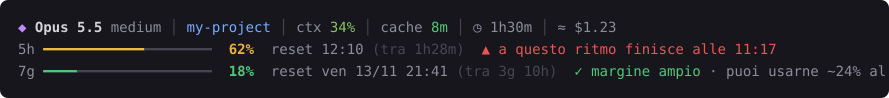

# claude-limiti

**I limiti di utilizzo di Claude Code, in tempo reale, sotto la chat**: la finestra di 5 ore e
quella settimanale, quando si azzerano, se li stai consumando troppo in fretta e quando li
finirai. In più la skill `/limiti` per un report dettagliato e per personalizzare la barra
semplicemente chiedendolo a Claude.



*[Read in English](README.md)*

## Cosa fa

- **Barre dei limiti sempre visibili**: percentuale usata, ora del reset (con la data per il
  settimanale) e tempo che manca. La barra è verde, gialla (dal 50%) o rossa (dall'80%).
- **Ritmo**: confronta quanto hai consumato con il tempo passato nella finestra
  (`✓ margine ampio`, `● nella media`, `▲ consumi in fretta`).
- **Previsione**: se finirai il limite prima del reset, ti dice quando (5 ore: ritmo dell'ultima ora; settimanale: media dall'inizio della finestra).
- **Limite di spesa**: dietro un gateway Claude apps con limite di spesa, una terza barra lo mostra.
- **Budget giornaliero**: quanto puoi usare in media ogni giorno fino al reset settimanale.
- **Notifiche** quando superi le soglie (predefinite 80% e 95%) e quando il limite si azzera.
  Windows, macOS e Linux (`notify-send`).
- **Riga di contesto**: modello, effort, cartella, branch git, contesto usato, scadenza della cache,
  durata e costo stimato della sessione.
- **Skill `/limiti`**: report con le ultime 10 ore e l'ultima settimana, più un consiglio se serve.
- **Si adatta alla larghezza**: nei terminali stretti le righe si accorciano da sole.
- **Più sessioni insieme**: una sessione ferma non sovrascrive i dati più recenti e ogni
  notifica arriva una volta sola.
- **Italiano e inglese**, scelti in base alla lingua del sistema.

## Requisiti

- [Claude Code](https://code.claude.com) con un abbonamento claude.ai **Pro, Max o Ultra**: solo
  in questo caso Claude Code fornisce i limiti, dopo la prima risposta di ogni sessione. Con una
  chiave API la barra dice che i limiti non sono disponibili.
- [Node.js](https://nodejs.org) 18 o successivo.

Funziona in qualsiasi terminale, anche quello integrato di VS Code, su Windows, macOS e Linux.

## Installazione

```
git clone https://github.com/raffaeleciccone-analyst/claude-limiti.git
cd claude-limiti
node install.mjs
```

Poi riavvia Claude Code.

L'installatore copia la skill in `~/.claude/skills/limiti` e attiva la status line in
`~/.claude/settings.json` (il file originale viene salvato una volta in `settings.json.bak-limiti`).
Se hai già una status line, l'installatore non la tocca e si ferma; con `node install.mjs --forza`
la sostituisce, la salva e la rimette se un giorno disinstalli.

**Aggiornare:** `git pull` e di nuovo `node install.mjs`. Le tue preferenze restano.

## Personalizzazione

Basta chiederlo a Claude: *"/limiti cambia lo stile della barra"*, *"barre più lunghe"*,
*"togli il costo"*, *"avvisami al 70%"*. Oppure da terminale:

```
node ~/.claude/skills/limiti/settings.mjs                 # impostazioni attuali
node ~/.claude/skills/limiti/settings.mjs stili           # anteprima degli stili
node ~/.claude/skills/limiti/settings.mjs stile blocchi
node ~/.claude/skills/limiti/settings.mjs reset
```

Nomi e valori si possono scrivere in italiano o in inglese.

| Impostazione | Valori | Predefinito |
|---|---|---|
| `stile` (`style`) | `linea` ━━━ · `blocchi` ██░░ · `sottile` ━━── · `quadrati` ■■□□ · `pallini` ●●○○ · `rombi` ◆◆◇◇ · `ascii` ##-- | `linea` |
| `larghezza` (`width`) | da 8 a 40 caratteri | `20` |
| `spazio` (`gap`) | riga vuota tra la barra 5h e la 7g | `no` |
| `parentesi` (`brackets`) | barra tra `[ ]` | `no` |
| `compatto` (`compact`) | tutte le barre su una riga, con barre da 8 caratteri: `auto` (sotto 70 colonne) · `sempre` · `mai` | `auto` |
| `notifiche` (`notifications`) | `sì` · `no` | `sì` |
| `soglie` (`thresholds`) | percentuali a cui avvisare, es. `70,90` | `80,95` |
| `mostra_contesto` (`show_context`) | riga con modello, cartella e contesto | `sì` |
| `mostra_costo` (`show_cost`) | costo stimato della sessione | `sì` |
| `mostra_git` (`show_git`) | branch git | `sì` |
| `colori` (`colors`) | `auto` · `truecolor` · `256` · `nessuno` (spenti anche con `NO_COLOR`) | `auto` |
| `simboli` (`symbols`) | `unicode` · `ascii` (se vedi quadratini al posto dei simboli) | `unicode` |
| `lingua` (`language`) | `auto` · `it` · `en` | `auto` |

Le modifiche si vedono dalla risposta successiva, senza riavviare. Le preferenze sono salvate in
`~/.claude/statusline-limiti.config.json`.

La barra usa solo simboli presenti nei font da terminale e larghi una colonna, mai emoji (vengono
disegnate larghe due colonne e si sovrappongono al testo), così tutto resta allineato.

## Problemi comuni

- **Non vedo la barra.** Riavvia Claude Code. Controlla che `node --version` funzioni nel
  terminale. Prova lo script a mano: `echo {} | node ~/.claude/skills/limiti/statusline.mjs`
  deve scrivere "limiti: in attesa della prima risposta".
- **"limiti non disponibili: servono Pro, Max o Ultra".** Stai usando una chiave API o un
  provider cloud: in questo caso Claude Code non invia i limiti dell'abbonamento.
- **Quadratini o punti di domanda al posto dei simboli.** Chiedi `simboli ascii` e `stile ascii`.
- **Colori strani.** Prova `colori 256`, oppure `colori nessuno`.
- **Niente notifiche su Linux.** Installa `notify-send` (pacchetto `libnotify-bin` o `libnotify`).
  Su Windows le notifiche risultano inviate da "Windows PowerShell".

## Privacy e sicurezza

Tutto resta sul tuo computer: nessuna connessione di rete e nessuna dipendenza esterna. I dati
arrivano da Claude Code stesso; lo storico è salvato in `~/.claude/state/limiti-utilizzo.json`
(percentuali, orari, identificativi delle sessioni di Claude Code e, con un gateway a limite di spesa, l'importo speso; ultimi 8 giorni). I testi che arrivano da fuori (nome del modello,
cartella, branch git) vengono ripuliti dai caratteri di controllo prima di essere stampati, e le
notifiche sono avviate con percorsi assoluti.

## Disinstallazione

```
node install.mjs --rimuovi
```

Toglie la status line (rimettendo quella che avevi prima, se c'era) e la skill. Preferenze e
storico restano in `~/.claude`: cancellali a mano se non ti servono.

## Sviluppo

```
node test/test.mjs           # 207 controlli, tutti in cartelle temporanee
node tools/preview-svg.mjs   # rigenera le immagini in docs/
```

`CLAUDE_CONFIG_DIR` viene rispettata. I test girano su GitHub Actions su Windows, macOS e Linux con Node 18 e 22.

## Licenza

[MIT](LICENSE)
