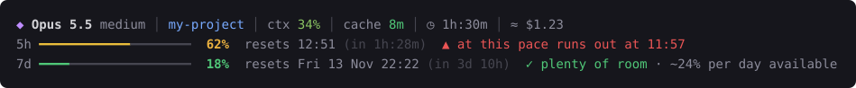

# claude-limiti

**Live Claude Code usage limits in your status line**: the 5-hour and weekly windows, when they
reset, whether you are burning through them too fast, and when you will run out. Plus a `/limiti`
skill for a detailed report and for customizing the bar just by asking Claude.



*[Leggi in italiano](README.it.md)*

## Features

- **Always-visible limit bars**: percentage used, reset time (with the date for the weekly window)
  and time left. The bar turns green, yellow (50%+) and red (80%+).
- **Pace**: compares what you used with the time elapsed in the window
  (`✓ plenty of room`, `● on pace`, `▲ burning fast`).
- **Forecast**: if you will run out before the reset, it tells you when (5-hour window: pace of the last hour; weekly: average since the window started).
- **Spend limit**: behind a Claude apps gateway with a spend limit, a third bar shows it.
- **Daily budget**: how much you can use per day until the weekly reset.
- **Notifications** when you cross the thresholds (80% and 95% by default) and when a limit
  resets. Windows, macOS and Linux (`notify-send`).
- **Context line**: model, effort, folder, git branch, context used, prompt-cache expiry,
  session duration and estimated cost.
- **`/limiti` skill**: report with the last 10 hours and the last week, plus one tip when needed.
- **Fits any width**: lines shorten automatically on narrow terminals.
- **Several sessions at once**: an idle session never overwrites fresher numbers, and each
  notification is sent only once.
- **English and Italian**, picked from your system language.

## Requirements

- [Claude Code](https://code.claude.com) with a claude.ai **Pro, Max or Ultra** plan: only then
  does Claude Code provide the limits, after the first response of each session. With an API key
  the bar says that limits are unavailable.
- [Node.js](https://nodejs.org) 18 or later.

Works in any terminal, including the VS Code integrated terminal, on Windows, macOS and Linux.

## Install

```
git clone https://github.com/raffaeleciccone-analyst/claude-limiti.git
cd claude-limiti
node install.mjs
```

Then restart Claude Code.

The installer copies the skill to `~/.claude/skills/limiti` and enables the status line in
`~/.claude/settings.json` (the original file is backed up once to `settings.json.bak-limiti`).
If you already have a status line, it is left alone and the installer stops; `node install.mjs --force`
replaces it, saves it, and puts it back if you uninstall.

**Update:** `git pull`, then `node install.mjs` again. Your preferences are kept.

## Customize

Just ask Claude: *"/limiti change the bar style"*, *"longer bars"*, *"hide the cost"*,
*"alert me at 70%"*. Or from a terminal:

```
node ~/.claude/skills/limiti/settings.mjs                 # current settings
node ~/.claude/skills/limiti/settings.mjs styles          # preview every style
node ~/.claude/skills/limiti/settings.mjs style blocks
node ~/.claude/skills/limiti/settings.mjs reset
```

| Setting | Values | Default |
|---|---|---|
| `style` | `line` ━━━ · `blocks` ██░░ · `thin` ━━── · `squares` ■■□□ · `dots` ●●○○ · `diamonds` ◆◆◇◇ · `ascii` ##-- | `line` |
| `width` | 8 to 40 characters | `20` |
| `gap` | blank line between the 5h and 7d bars | `false` |
| `brackets` | bar inside `[ ]` | `false` |
| `compact` | all bars on one line, with 8-character bars: `auto` (under 70 columns) · `always` · `never` | `auto` |
| `notifications` | `true` · `false` | `true` |
| `thresholds` | percentages that trigger an alert, e.g. `70,90` | `80,95` |
| `show_context` | line with model, folder and context | `true` |
| `show_cost` | estimated session cost | `true` |
| `show_git` | git branch | `true` |
| `colors` | `auto` · `truecolor` · `256` · `none` (also off when `NO_COLOR` is set) | `auto` |
| `symbols` | `unicode` · `ascii` (if you see boxes instead of symbols) | `unicode` |
| `language` | `auto` · `en` · `it` | `auto` |
| `scheduled_reset` | Windows: when a limit passes the first threshold, a one-time Windows task shows the "limit reset" notification at the reset time even with every session closed, then deletes itself | `false` |
| `diagnostics` | logs every reading locally, to check how it works (see below) | `false` |

Changes show from the next response, no restart needed. Preferences are stored in
`~/.claude/statusline-limiti.config.json`.

The bar only uses one-column symbols found in terminal fonts, never emoji (they are drawn two
columns wide and overlap the text), so everything stays aligned.

## Troubleshooting

- **VS Code: no bar in the graphical panel.** The Claude Code panel in VS Code does not run custom status lines (checked with Claude Code 2.1.322). Run `claude` in the VS Code integrated terminal, or turn on *Extensions → Claude Code → Use Terminal*.
- **No bar at all.** Restart Claude Code. Check that `node --version` works in your terminal.
  Run the script by hand: `echo {} | node ~/.claude/skills/limiti/statusline.mjs` should print
  "limits: waiting for the first response".
- **"limits unavailable: requires Pro, Max or Ultra".** You are using an API key or a cloud
  provider: Claude Code does not send subscription limits in that case.
- **Boxes or question marks instead of symbols.** Ask for `symbols ascii` and `style ascii`.
- **Strange colors.** Try `colors 256`, or `colors none`.
- **No notifications on Linux.** Install `notify-send` (package `libnotify-bin` or `libnotify`).
  On Windows they appear as coming from "Windows PowerShell".

## How it works

A plain-language walkthrough (in Italian) is in [docs/come-funziona.md](docs/come-funziona.md).

## Checking how it works

The bar relies on a few things Claude Code does not document, such as how to tell a fresh
reading from an old one when several sessions are open. To check them with your own data,
turn on `diagnostics`, use Claude Code for a few days, then run:

```
node ~/.claude/skills/limiti/report.mjs diagnostics
```

Each line says OK or CHECK. A CHECK is worth an issue on GitHub.

## Privacy and security

Everything stays on your computer: no network connections and no dependencies. The data comes
from Claude Code itself; the history is stored in `~/.claude/state/limiti-utilizzo.json`
(percentages, times, Claude Code session IDs and, behind a spend-limit gateway, the amount spent; last 8 days). Text from outside (model name, folder, git branch) is
stripped of control characters before being printed, and notifications are launched with absolute
paths.

## Uninstall

```
node install.mjs --remove
```

Removes the status line (restoring the previous one, if any) and the skill. Preferences and
history stay in `~/.claude`: delete them by hand if you do not need them.

## Development

```
node test/test.mjs           # 226 checks, all in temporary folders
node tools/preview-svg.mjs   # regenerates the images in docs/
```

`CLAUDE_CONFIG_DIR` is respected. Tests run on GitHub Actions on Windows, macOS and Linux with Node 18 and 22.

## License

[MIT](LICENSE)
